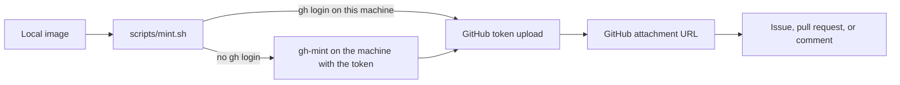

# github-attachments

Upload images to GitHub issues, pull requests, and comments from an AI coding agent or the terminal—without committing them to the repository.

Diagram of one upload:



## Quick start

Install the tagged skill:

```bash
DO_NOT_TRACK=1 npx skills add https://github.com/asabirov/github-attachments-skill/tree/v0.2.0 --skill github-attachments --agent claude-code codex --global
```

`DO_NOT_TRACK=1` tells the skills CLI not to send telemetry. The command installs the `v0.2.0` release tag.

Then ask your agent:

> Attach screenshot.png to issue 12 in example-owner/example-repo.

The agent uploads the file and puts the image in the issue. The agent instructions are in [SKILL.md](SKILL.md). The skill version is in `metadata.version` in [SKILL.md](SKILL.md).

### What it needs

| Dependency | Needed for |
| --- | --- |
| Node.js, npm and Git | the `npx skills` installer |
| Bash | running `scripts/mint.sh` |
| Node.js 21 or later | the upload request in `scripts/drivers/token.mjs` |
| a `gh` login on this machine, or the GitHub broker's `gh-mint` command | the GitHub token for the upload. `gh-mint` sends the file to another machine that holds the token. |

The tool has no npm dependencies and works on a headless host.

### Run the script directly

From the installed skill folder:

```bash
# Uploads a local file to GitHub. Replace the path and repository first.
scripts/mint.sh screenshot.png --repo example-owner/example-repo --format markdown
```

The command uploads the file and prints Markdown for an issue, pull request, or comment in the same repository. It does not submit the issue or comment.

Example output (synthetic ID, not a live attachment):

```markdown

```

Run `scripts/mint.sh --help` for the current options and defaults.

## Why it exists

Screenshots can help explain a review but do not belong in the repository's Git history. This helper uploads a local image and returns a GitHub attachment URL, so an agent or developer can add visual evidence without sending the file through the conversation.

Version 0.1.0 drove a signed-in browser and pasted the file into GitHub's own editor, because that was then the only route this skill had; the 422 that proved it is in #3 and in this repository's git history. GitHub's token upload does it in one request, so the browser drivers are gone.

## Limits and authentication

See [SKILL.md](SKILL.md) for supported files, authentication routes, limits, exit codes, and upload behavior.

## Update, roll back, and remove

Update to a later release tag with the install command and its new tag. Roll back by rerunning it with the previous release tag. Remove it with:

```bash
DO_NOT_TRACK=1 npx skills remove github-attachments --agent claude-code codex --global
```

## Tests and contributions

Run the offline test suite from the repository root:

```bash
tests/mint-cli.test.sh
```

It uses synthetic fixtures and does not upload files or contact GitHub. To check a real upload, mint an image, embed its URL, and read the rendered body back.

For changes, open an issue, work on a branch, run the tests, and submit a pull request. Keep credentials and private attachments out of the repository. Maintainers find the release steps in [AGENTS.md](AGENTS.md).

## License

[MIT](LICENSE), copyright 2026 Artur Sabirov.
