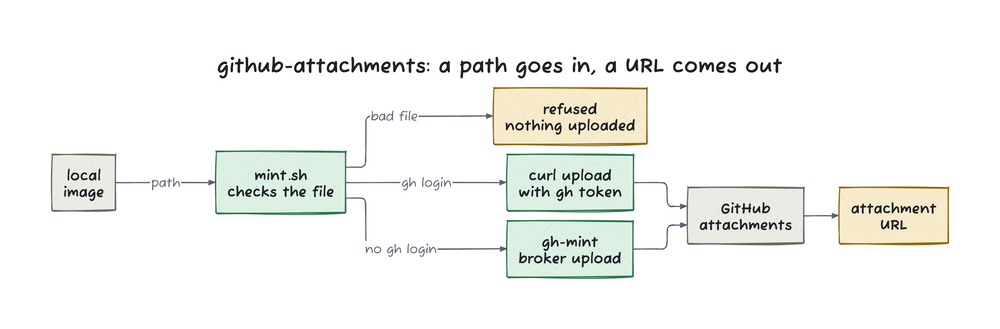

# github-attachments

[](https://github.com/asabirov/github-attachments-skill/releases) [](LICENSE)

Upload images to GitHub issues, pull requests, and comments from an AI coding agent or the terminal—without committing them to the repository.



## Why it exists, and what it turned down

Screenshots can help explain a review but do not belong in the repository's Git history. This helper returns a GitHub attachment URL, so an agent or developer can add visual evidence without sending the file through the conversation.

| Option | Outcome | Reason |
| --- | --- | --- |
| Commit the image | Turned down | The image stays in Git history. |
| Send the image through the conversation | Turned down | The bytes use the agent's context. [SKILL.md](SKILL.md) has the numbers. |
| Drive a signed-in browser | Removed after 0.1.0 | GitHub's token upload does it in one request. The 422 that once forced the browser route is in [#3](https://github.com/asabirov/github-attachments-skill/issues/3). |
| Upload with Node.js | Replaced | `curl` and `gh` send the same request ([#43](https://github.com/asabirov/github-attachments-skill/issues/43)). |

## Design

| Choice | What it means for you |
| --- | --- |
| A path goes in, a URL comes out | Image bytes never pass through the conversation. |
| `--repo` is required | GitHub binds the attachment to that repository. |
| The file is checked first | A PDF, a file over 10 MB or a wrong file type costs no upload. |
| Two token routes | Use a `gh` login, or `gh-mint` on a machine without one. |
| It prints and does not post | You or your agent decide where the URL goes. |
| No browser and no npm dependencies | It works on a headless host. |

## What's where

| Path | Owns |
| --- | --- |
| [SKILL.md](SKILL.md) | What the agent does: supported files, authentication routes, limits, exit codes and upload behavior |
| `scripts/mint.sh` | The command: arguments, the early file checks and the output format |
| `scripts/drivers/token.sh` | The upload: the token route and the request to GitHub |
| `tests/mint-cli.test.sh` | The offline tests |
| `docs/diagrams/` | The diagram above and its source |
| [AGENTS.md](AGENTS.md) | The release steps for maintainers |

## How to run and verify it

Put any PDF named `notes.pdf` in the current folder. This check needs no login and uploads nothing. It exits with code 2:

```console
$ scripts/mint.sh notes.pdf --repo example-owner/example-repo
mint: notes.pdf is a PDF, and this skill uploads images only; keep documents in a document store and link to them
```

### Quick start

Install the latest version:

```sh
DO_NOT_TRACK=1 npx skills add https://github.com/asabirov/github-attachments-skill --skill github-attachments --agent claude-code codex --global -y
```

Update it later:

```sh
DO_NOT_TRACK=1 npx skills update github-attachments --global
```

`DO_NOT_TRACK=1` turns off the telemetry of the skills CLI. The CLI needs Node.js, npm and Git.

Then ask your agent:

> Attach screenshot.png to issue 12 in example-owner/example-repo.

The agent uploads the file and puts the image in the issue. The skill version is in `metadata.version` in [SKILL.md](SKILL.md).

### What it needs

| Dependency | Needed for |
| --- | --- |
| Node.js 22.20.0 or later, npm and Git | the `npx skills` installer |
| Bash | running `scripts/mint.sh` and the upload |
| `curl` | the upload request |
| a `gh` login on this machine, or the GitHub broker's `gh-mint` command | the GitHub token for the upload. `gh-mint` sends the file to another machine that holds the token. |

### Run the script directly

From the installed skill folder:

```bash
# Uploads a local file to GitHub. Replace the path and repository first.
scripts/mint.sh screenshot.png --repo example-owner/example-repo --format markdown
```

The command prints Markdown for an issue, pull request, or comment in the same repository.

Example output (synthetic ID, not a live attachment):

```markdown

```

Run `scripts/mint.sh --help` for the current options and defaults.

### Remove it

```bash
DO_NOT_TRACK=1 npx skills remove github-attachments --agent claude-code codex --global -y
```

### Tests and contributions

Run the offline test suite from the repository root:

```bash
tests/mint-cli.test.sh
```

It uses synthetic fixtures and does not upload files or contact GitHub. To check a real upload, mint an image, embed its URL, and read the rendered body back.

For changes, open an issue, work on a branch, run the tests, and submit a pull request. Keep credentials and private attachments out of the repository.

## License

[MIT](LICENSE), copyright 2026 Artur Sabirov.
